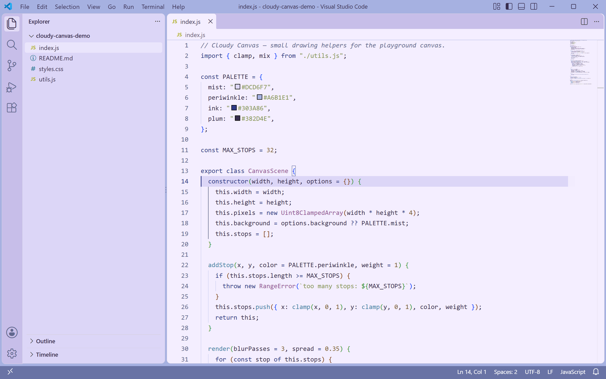
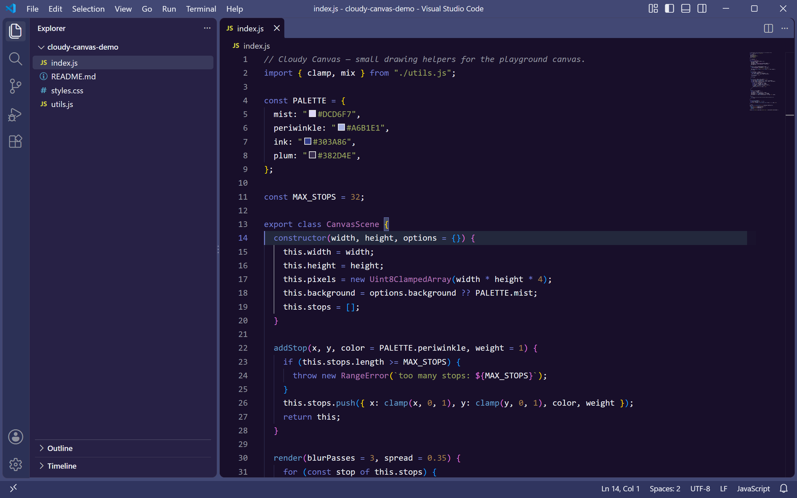

<p align="center">
  
</p>

<h1 align="center">Cloudy Canvas Theme</h1>

<p align="center">
  <a href="https://marketplace.visualstudio.com/items?itemName=lilinhuang.cloudy-canvas-theme">
    
  </a>
</p>

<p align="center">
  A calm lavender VS Code theme built on soft clouds and a blank canvas — periwinkle light, deep indigo night.
  <br>
  一套安静的薰衣草色 VS Code 主题，灵感来自云朵与空白画布 —— 浅色是雾紫蓝，深色是靛蓝夜。
</p>

---

## Features

- **Light &amp; dark as a pair** — `Cloudy Canvas Theme Light` and `Cloudy Canvas Theme Dark`, tuned together so switching feels natural.
  **浅深成对** —— `Cloudy Canvas Theme Light` 与 `Cloudy Canvas Theme Dark` 成对调校，切换不生硬。
- **Soft lavender palette** — periwinkle, mist lavender and deep indigo. Never pure white, never pure black.
  **柔和薰衣草色系** —— 长春花蓝、雾紫与深靛，不用纯白也不用纯黑。
- **Full UI theming** — title bar, activity bar, sidebar, tabs, panels, status bar, terminal and git decorations.
  **完整 UI 覆盖** —— 标题栏、活动栏、侧边栏、标签页、面板、状态栏、终端与 Git 标记。
- **Comfortable syntax contrast** — keywords, strings, numbers, types and comments all kept readable for long sessions.
  **舒服的语法对比度** —— 关键字、字符串、数字、类型与注释都保持可读，适合长时间编码。
- **Semantic highlighting** — `semanticHighlighting` is enabled for sharper TypeScript, JavaScript and Python.
  **语义高亮** —— 开启 `semanticHighlighting`，TypeScript、JavaScript、Python 着色更准。

## Screenshots

### Cloudy Canvas Theme Light

Editor `#F4EEFF`, sidebar `#DCD6F7`, title bar `#A6B1E1` — a soft lavender workspace for daytime.

编辑器 `#F4EEFF`、侧边栏 `#DCD6F7`、标题栏 `#A6B1E1`，白天用的柔和薰衣草工作区。

<p align="center">
  
</p>

### Cloudy Canvas Theme Dark

Editor `#180F2A`, sidebar `#272145`, accent `#717CCC` — the same palette after dusk.

编辑器 `#180F2A`、侧边栏 `#272145`、强调色 `#717CCC`，入夜后的同一套配色。

<p align="center">
  
</p>

## Installation

### From the Marketplace

1. Open the Extensions view (`Ctrl+Shift+X`).
   打开扩展视图（`Ctrl+Shift+X`）。
2. Search for **"Cloudy Canvas"**.
   搜索 **"Cloudy Canvas"**。
3. Click **Install**.
   点击 **Install**。
4. Press `Ctrl+K Ctrl+T` and pick **Cloudy Canvas Theme Light** or **Cloudy Canvas Theme Dark**.
   按 `Ctrl+K Ctrl+T`，选择 **Cloudy Canvas Theme Light** 或 **Cloudy Canvas Theme Dark**。

### Manual install

```bash
code --install-extension cloudy-canvas-theme-1.0.0.vsix
```

## Color Palette

| Role | Light | Dark |
|------|-------|------|
| Editor background | `#F4EEFF` | `#180F2A` |
| Sidebar | `#DCD6F7` | `#272145` |
| Activity bar | `#C7BEE9` | `#2C3156` |
| Title bar | `#A6B1E1` | `#424874` |
| Status bar | `#6973A5` | `#30355F` |
| Accent / links | `#303A86` | `#717CCC` |
| Keywords | `#303A86` | `#717CCC` |
| Functions | `#457EA7` | `#629CC7` |
| Strings | `#869456` | `#98A25E` |
| Numbers | `#7B6038` | `#A27F4A` |
| Types | `#915694` | `#AE73B3` |
| Comments | `#61678E` | `#90939F` |

## Customization

Any colour can be overridden in your `settings.json`:

```jsonc
{
  "workbench.colorCustomizations": {
    // applies to both variants
    "editorCursor.foreground": "#303A86",

    // or scope it to one variant
    "[Cloudy Canvas Theme Dark]": {
      "editor.background": "#150D26"
    }
  }
}
```

## Credits

Designed by [Li Lin Huang](https://github.com/vaxicy) — the theme grew out of a blank canvas, a soft cloud and far too many nights of tuning contrast.
由 [Li Lin Huang](https://github.com/vaxicy) 设计 —— 从一块空白画布、一朵软云，以及无数个调对比度的夜晚开始。

## License

[Non-Commercial License](LICENSE) — Free for personal, educational and non-commercial use. Commercial use requires written permission.
[非商业许可](LICENSE) — 免费用于个人、教育与非商业场景。商业用途需获得书面授权。
